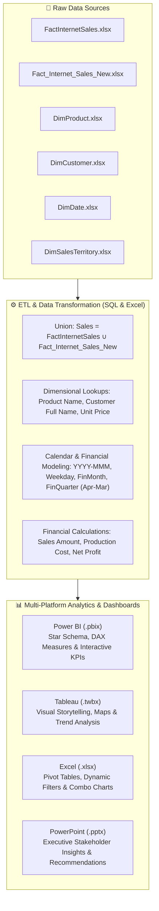

# 🚴 Adventure Works Cycles — End-to-End Sales Analytics & BI

[](https://github.com/MasterRohitPatil/Adventure-Works-Data-Analyst)
[](https://products.office.com/excel)
[](https://www.mysql.com/)
[](https://powerbi.microsoft.com/)
[](https://www.tableau.com/)
[](https://office.com/)

---

## 📌 Executive Summary

**Adventure Works Cycles** is a multinational manufacturing company producing and distributing commercial bicycles, accessories, and components across North American, European, and Asian commercial markets. 

This project delivers an **end-to-end data analytics, ETL pipeline, and business intelligence reporting solution**. The analysis integrates historical transaction records, builds dimensional data models, develops custom calendar and financial period logic, computes key financial KPIs (Sales Amount, Production Cost, Profit Margins), and delivers interactive dashboards and executive presentations across **SQL, Excel, Power BI, and Tableau**.

---

## 🏗️ Analytics Workflow & Architecture



---

## 🎯 Business Requirements & Implementation Matrix

| # | Task / Requirement | Implementation Details | SQL / DAX Logic |
|---|---|---|---|
| **0** | **Data Union** | Combine historical and recent online sales data | `UNION ALL` across `FactInternetSales` & `fact_internet_sales_new` |
| **1** | **Product Lookup** | Bring `EnglishProductName` into unified sales records | Primary key indexing on `ProductKey` with `LEFT JOIN` / `XLOOKUP` |
| **2** | **Customer & Price Lookup** | Consolidate `CustomerFullName` and base `UnitPrice` | `CONCAT_WS(' ', FirstName, LastName)` with `CustomerKey` relation |
| **3** | **Date & Financial Calendar** | Custom fiscal year calendar (Fiscal Year starts in April) | Derive `Year`, `MonthNo`, `MonthFullName`, `QuarterName`, `YearMonth`, `WeekdayNo`, `WeekdayName`, `FinancialMonth`, `FinancialQuarter` |
| **4** | **Sales Amount Calculation** | Calculate net revenue accounting for discounts | `UnitPrice * OrderQuantity * (1 - UnitPriceDiscountPct)` |
| **5** | **Production Cost Calculation** | Total manufacturing cost per order | `ProductStandardCost * OrderQuantity` |
| **6** | **Profit Margin Calculation** | Net gross profit generated per line item | `SalesAmount - ProductionCost` |
| **7** | **Monthly Sales Pivot** | Dynamic monthly revenue matrix with Year filtering | Interactive Pivot Tables with slicers for fiscal period analysis |
| **8-10**| **Trend & Distribution Charts** | Year-wise Bar chart, Month-wise Line chart, Quarter Pie chart | Temporal trends and seasonal peak identification |
| **11**| **Dual-Axis Combo Chart** | Revenue vs. Cost comparison in one unified view | Clustered column for Sales Amount + Line overlay for Production Cost |
| **12-13**| **Interactive Dashboards** | Full executive dashboard suite | Built in **Power BI (.pbix)** and **Tableau (.twbx)** |

---

## 📂 Repository File Structure

```plaintext
├── 📊 Dashboards & Presentation Deliverables
│   ├── Group1_Adventure_project_Excel.xlsx       # Comprehensive 30MB Excel workbook with models, formulas & pivots
│   ├── Group1_AdventureWorks_PowerBI.pbix        # Interactive Power BI report with star schema & DAX measures
│   ├── Group1_AdventureWorks_tableau.twbx        # Packaged Tableau workbook with dashboards & storyboards
│   ├── Group_1 Adventure Works Sales Analysis.pptx# Executive presentation with key findings & recommendations
│   └── Group1_AdventureWorks.sql                 # Complete MySQL script: schema creation, ETL, queries & KPIs
│
├── 📑 Documentation & Specifications
│   ├── Adventure details.docx                    # Business background and problem statement
│   └── Questinaires.xlsx                         # Project task list and evaluation criteria
│
└── 🗃️ Dimension & Fact Datasets
    ├── FactInternetSales.xlsx                    # Historical online sales transactions
    ├── Fact_Internet_Sales_New.xlsx              # New batch online sales transactions
    ├── Dimcustomer.xlsx                          # Customer demographic & contact information
    ├── DimDate.xlsx                              # Calendar master dimension
    ├── DimProduct.xlsx                           # Product catalog and standard pricing
    ├── DimProductCategory.xlsx                   # High-level product categories (Bikes, Components, etc.)
    ├── DimProductSubCategory.xlsx                # Detailed subcategories (Mountain Bikes, Road Bikes, etc.)
    └── DimSalesterritory.xlsx                    # Regional sales territory mapping (US, Europe, Pacific)
```

---

## 📈 Key Insights & Business Recommendations

1. **Revenue Drivers**:
   - **Bicycles** remain the highest revenue generator, led by Road Bikes and Mountain Bikes, while **Accessories & Components** offer high purchase frequency with consistent gross profit margins.
2. **Seasonal Sales Peaks**:
   - Sales volume significantly increases in **Q2 & Q4**, correlating with seasonal cycling demand and holiday promotional events.
3. **Geographic Distribution**:
   - North America accounts for the largest share of online sales, followed by Western European regions with growing market penetration in the Pacific territory.
4. **Profitability Optimization**:
   - Discounts on low-margin products erode profitability; implementing minimum margin thresholds for promotional campaigns is recommended.

---

## 🛠️ How to Explore the Project

1. **SQL Database Setup**:
   - Execute [`Group1_AdventureWorks.sql`](Group1_AdventureWorks.sql) in MySQL Workbench or your favorite SQL client to recreate the consolidated database and run analytical queries.
2. **Excel Data Model**:
   - Open [`Group1_Adventure_project_Excel.xlsx`](Group1_Adventure_project_Excel.xlsx) to review the formula-driven data model, pivot tables, and visualizations.
3. **Power BI Dashboard**:
   - Open [`Group1_AdventureWorks_PowerBI.pbix`](Group1_AdventureWorks_PowerBI.pbix) in Microsoft Power BI Desktop to interact with slicers, cross-filtering, and DAX measures.
4. **Tableau Storyboard**:
   - Open [`Group1_AdventureWorks_tableau.twbx`](Group1_AdventureWorks_tableau.twbx) in Tableau Desktop or Tableau Reader to inspect custom charts and geospatial maps.
5. **Executive Summary**:
   - Open [`Group_1 Adventure Works Sales Analysis.pptx`](Group_1%20Adventure%20Works%20Sales%20Analysis.pptx) for the slide-deck presentation.

---

## 👤 Author

- **Rohit Patil**
- **GitHub**: [@MasterRohitPatil](https://github.com/MasterRohitPatil)
